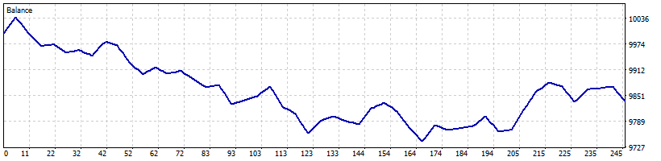

# AutoScalperHybrid.XAUUSD-2digit-M5.fast-test on XAUUSD M5

| Setting | Value |
|---|---|
| EA | AutoScalper Hybrid / Nyao v46 v46.1 (`mt5/Experts/AutoScalperHybrid.mq5`) |
| Settings | `mt5/Profiles/Presets/AutoScalperHybrid.XAUUSD-2digit-M5.fast-test.set` |
| Git commit | fb17954 + uncommitted changes |
| Symbol / timeframes | XAUUSD / M5 |
| Tick data | Every tick based on real ticks |
| Deposit / leverage | 10,000 USD / 1:500 |
| Runs | One run over the whole range |
| Generated | 2026-10-16 07:10 with `tools/backtest/nyao_backtest.py` |

## Summary

| Timeframe | Total return | Profitable | Best / worst run | Max drawdown | Trades | Win rate | Avg win / loss | Profit factor | Tick data |
|---|---|---|---|---|---|---|---|---|---|
| M5 | -1.6% | 0/1 | -1.6% / -1.6% | 3.0% | 245 | 51% | $3.76 / -$5.28 | 0.74 | 100% real ticks |

## Results per run

| Run | M5 |
|---|---|
| 2026-07..2026-07 | -1.6% (DD 3%, 245 trades) |

## Balance graphs

### M5

**2026-07..2026-07** -1.6%

