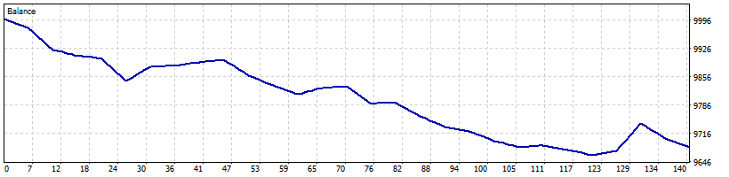

# Hybrid Fast profit trail August 2026 10k real ticks

| Setting | Value |
|---|---|
| EA | AutoScalper Hybrid / Nyao v46 v46.1 (`mt5/Experts/AutoScalperHybrid.mq5`) |
| Settings | `mt5/Profiles/Presets/AutoScalperHybrid.XAUUSD-2digit-M5.fast-test.set` |
| Git commit | fb17954 + uncommitted changes |
| Symbol / timeframes | XAUUSD / M5 |
| Tick data | Every tick based on real ticks |
| Deposit / leverage | 10,000 USD / 1:500 |
| Runs | One run over the whole range |
| Generated | 2026-10-15 21:59 with `tools/backtest/nyao_backtest.py` |

## Summary

| Timeframe | Total return | Profitable | Best / worst run | Max drawdown | Trades | Win rate | Avg win / loss | Profit factor | Tick data |
|---|---|---|---|---|---|---|---|---|---|
| M5 | -3.2% | 0/1 | -3.2% / -3.2% | 3.4% | 140 | 36% | $3.09 / -$5.25 | 0.33 | 93% real ticks |

## Results per run

| Run | M5 |
|---|---|
| 2026-08..2026-08 | -3.2% (DD 3%, 140 trades) |

## Balance graphs

### M5

**2026-08..2026-08** -3.2%

