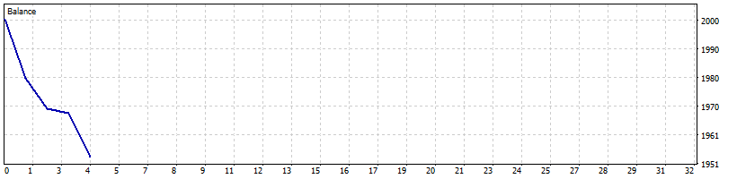

# Local MT5 Real-Tick Test Retry - September 2026

| Setting | Value |
|---|---|
| EA | Nyao Scalper v46.0 (`nyao_scalper.mq5`) |
| Settings | `settings/default.set` |
| Git commit | unknown |
| Symbol / timeframes | XAUUSD / M5 |
| Tick data | Every tick based on real ticks |
| Deposit / leverage | 2,000 USD / 1:500 |
| Runs | One run per month, each starting from a fresh deposit |
| Generated | 2026-10-15 01:20 with `tools/backtest/nyao_backtest.py` |

## Summary

Total return is the sum of the monthly returns (each month starts from the same deposit, not compounded).

| Timeframe | Total return | Profitable | Best / worst run | Max drawdown | Trades | Win rate | Avg win / loss | Profit factor | Tick data |
|---|---|---|---|---|---|---|---|---|---|
| M5 | -2.3% | 0/1 | -2.3% / -2.3% | 6.5% | 4 | 0% | $0.00 / -$11.64 | 0.00 | 100% real ticks |

## Results per run

| Run | M5 |
|---|---|
| 2026-09 | -2.3% (DD 7%, 4 trades) |

## Balance graphs

### M5

**2026-09** -2.3%

